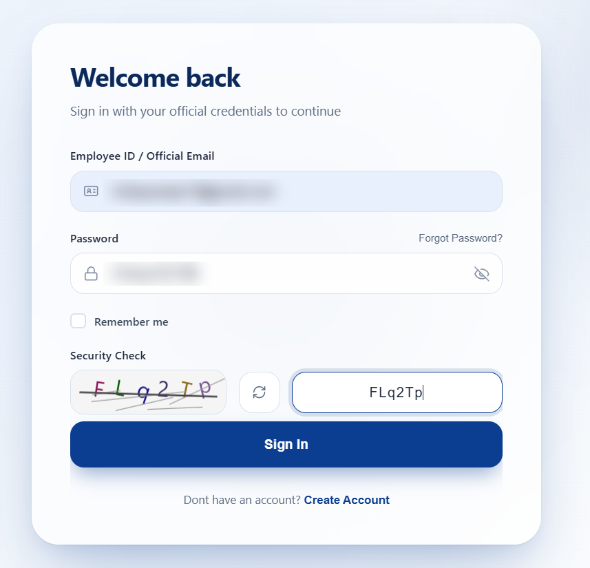
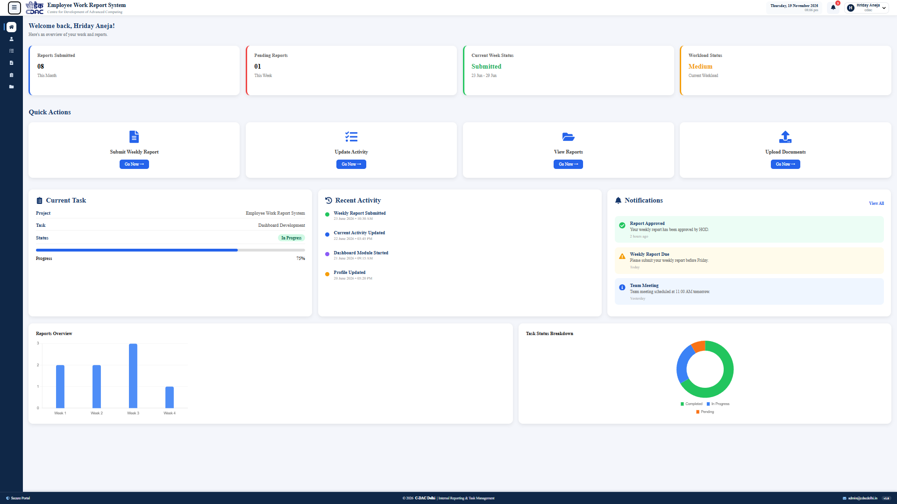
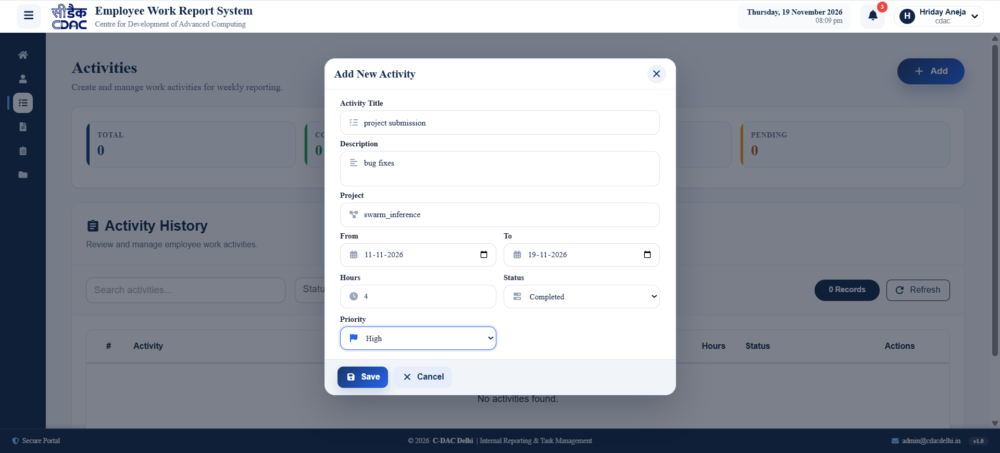
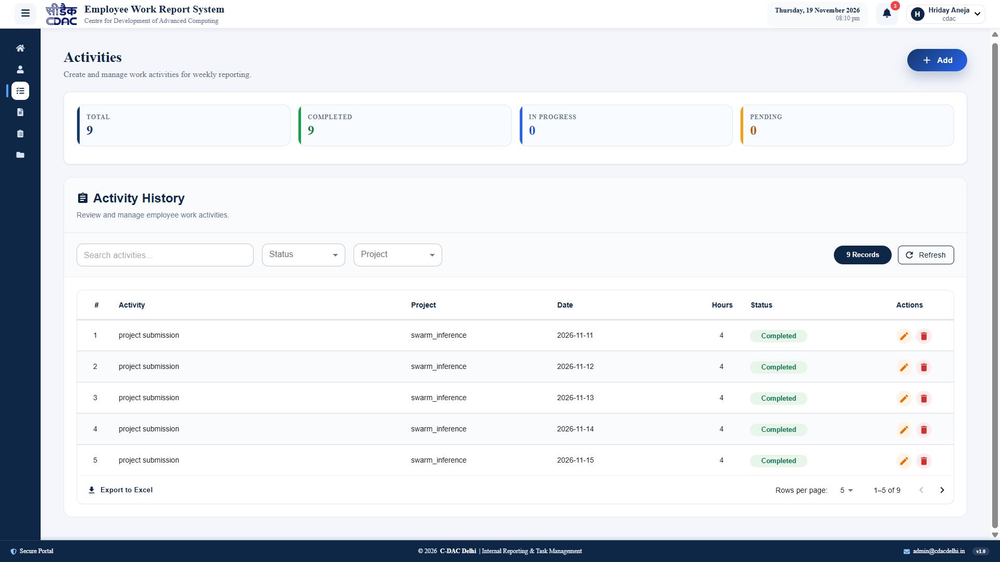
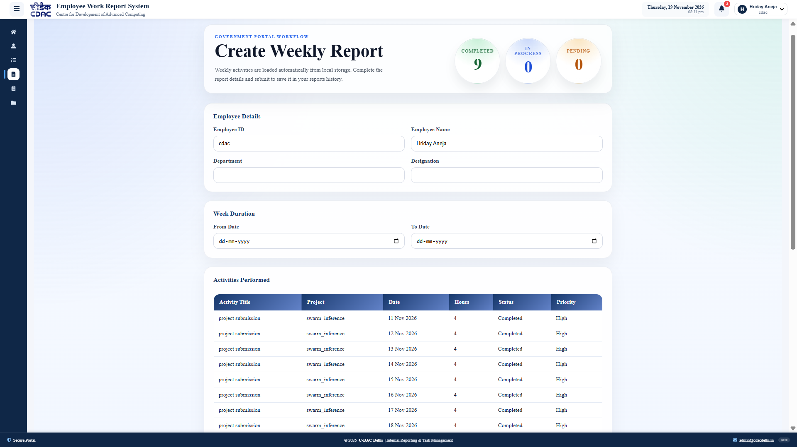
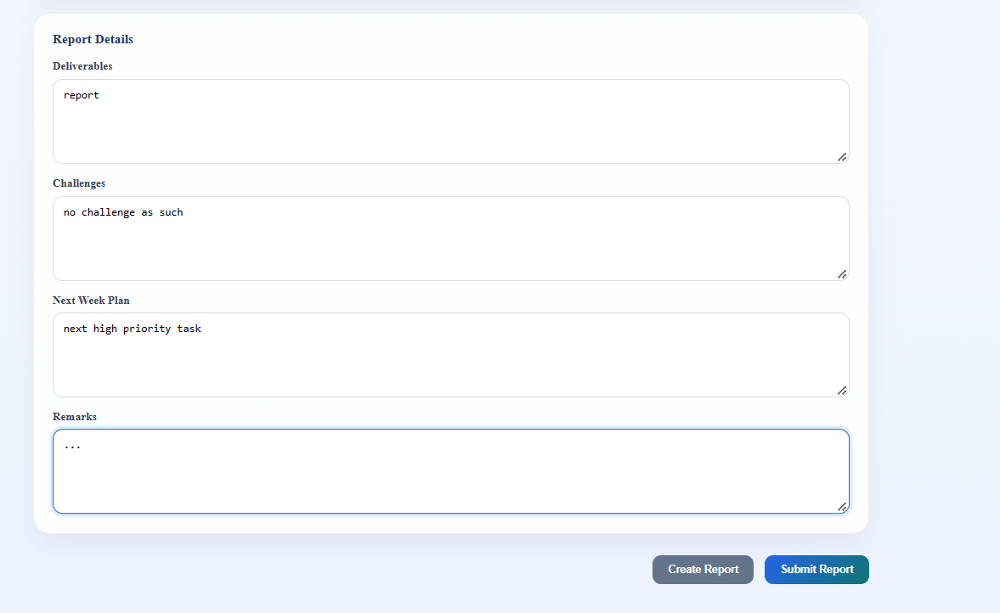
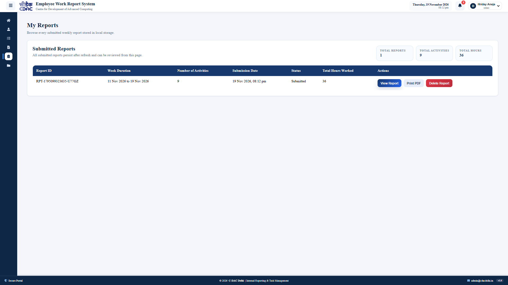
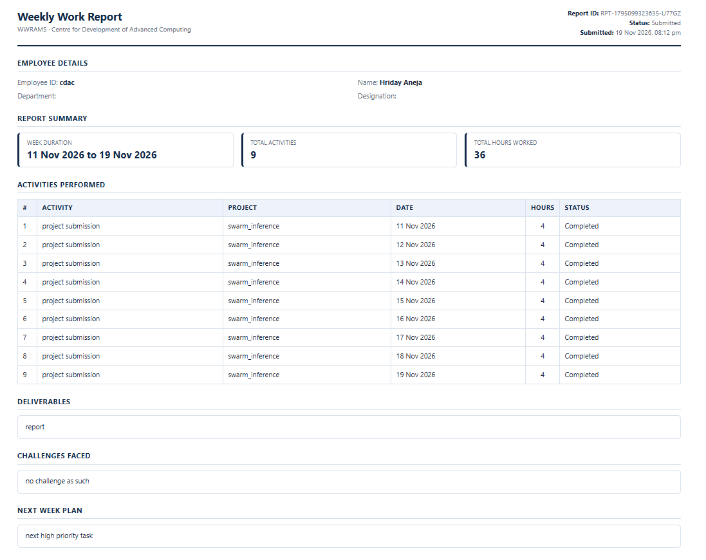
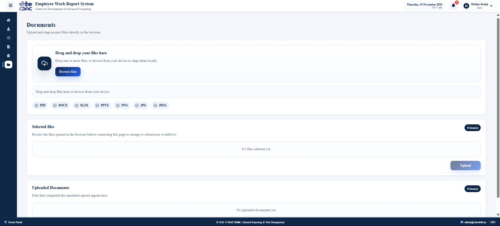
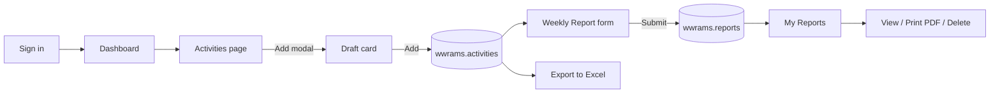

# Employee Work Report System (WWRAMS)

A web portal built during my internship at **C-DAC Delhi** (Centre for Development of Advanced Computing) that lets employees log their daily work activities, compile them into a **weekly work report**, and keep a history of every report they have submitted, with print-to-PDF and Excel export.

The app is a front-end-only React single-page application. All data is stored in the browser's `localStorage`, so it runs with no backend or database.

---

## Table of Contents

1. [Features](#features)
2. [Screenshots](#screenshots)
3. [Tech Stack](#tech-stack)
4. [Getting Started](#getting-started)
5. [Project Structure](#project-structure)
6. [Application Routes](#application-routes)
7. [How It Works](#how-it-works)
8. [Data Model & Storage](#data-model--storage)
9. [Validation Rules](#validation-rules)
10. [Known Limitations & Future Work](#known-limitations--future-work)

---

## Features

| Module | What it does |
| --- | --- |
| **Authentication** | Sign in with Employee ID or official email; two-step account creation; canvas-based CAPTCHA; live password-strength checklist; show/hide password. |
| **Dashboard** | Welcome banner, summary cards, quick-action shortcuts, current task, recent activity, notifications, and two Chart.js charts (reports per week, task status breakdown). |
| **Activities** | Add work activities through a modal (title, description, project, date range, hours, status, priority). Multi-day ranges are automatically split into one row per day. Searchable, filterable, paginated table with edit and delete dialogs and **Export to Excel**. |
| **Weekly Report** | Auto-loads the logged activities, shows Completed / In Progress / Pending counters, and collects the week duration, deliverables, challenges, next-week plan and remarks. The draft is auto-saved while typing. |
| **My Reports** | History of all submitted reports with totals (reports, activities, hours). View a report in a modal, **print / save as PDF**, or delete it. |
| **Documents** | Drag-and-drop or browse file upload (PDF, DOCX, XLSX, PPTX, PNG, JPG, JPEG, up to 25 MB each) with preview, progress bar and delete confirmation. |
| **App shell** | Collapsible sidebar, live date/time header, notification dropdown, profile menu with logout, and protected routes. |

---

## Screenshots

### Login
<p align="center">
  
</p>

Employee ID / email and password sign-in with a refreshable image CAPTCHA.

### Dashboard


> The dashboard cards, charts, notifications and recent-activity feed currently show placeholder data. See [Known Limitations](#known-limitations--future-work).

### Activities
Add a new activity from the modal:



Review, search, filter, edit, delete and export activities:



### Weekly Report
The form pulls in the employee details and every logged activity, then asks for the week duration:



Free-text sections at the bottom of the form:

<p align="center">
  
</p>

### My Reports


### Printable Report (Print PDF)
<p align="center">
  
</p>

### Documents


---

## Tech Stack

| Area | Technology |
| --- | --- |
| Framework | [React 19](https://react.dev/) |
| Build tool | [Vite 8](https://vite.dev/) with `@vitejs/plugin-react` |
| Routing | [React Router 7](https://reactrouter.com/) |
| Forms & validation | [React Hook Form](https://react-hook-form.com/) |
| UI components | [MUI (Material UI) 9](https://mui.com/) and MUI X Data Grid |
| Charts | [Chart.js 4](https://www.chartjs.org/) via `react-chartjs-2` |
| Animation | [Framer Motion](https://www.framer.com/motion/) |
| Icons | Font Awesome, `react-icons`, `lucide-react`, MUI Icons |
| Excel export | [SheetJS (`xlsx`)](https://sheetjs.com/) |
| Linting | [Oxlint](https://oxc.rs/docs/guide/usage/linter) |
| Storage | Browser `localStorage` (no backend) |

---

## Getting Started

### Prerequisites

- **Node.js** `^20.19.0` or `>=22.12.0` (required by Vite 8)
- **npm** 10 or newer

### Installation

```bash
# 1. Clone the repository
git clone https://github.com/Hriday-Aneja/internship_report.git
cd internship_report

# 2. Install dependencies
npm install

# 3. Start the dev server
npm run dev
```

The app is served at **http://localhost:5173**.

> **Note:** use `npm install` rather than `npm ci`. The committed `package-lock.json` is slightly out of sync with `package.json`, so `npm ci` fails until the lockfile is regenerated.

### Available Scripts

| Command | Description |
| --- | --- |
| `npm run dev` | Start the Vite dev server with hot module replacement. |
| `npm run build` | Create an optimized production build in `dist/`. |
| `npm run preview` | Serve the production build locally. |
| `npm run lint` | Lint the project with Oxlint. |

### Logging In

1. Open the app and click **Create Account** to register, or
2. use the demo account that is seeded automatically the first time no users exist in `localStorage`:

   | Employee ID | Email | Password |
   | --- | --- | --- |
   | `CDAC1234` | `user@cdac.in` | `password123` |

The demo account is for local testing only.

---

## Project Structure

```text
internship_report/
├── index.html                 # Vite entry HTML
├── vite.config.js
├── package.json
├── public/                    # Static assets (C-DAC logos, favicon)
└── src/
    ├── main.jsx               # React root + BrowserRouter
    ├── App.jsx                # Renders the route table
    ├── index.css / App.css    # Global styles
    ├── assets/                # Images bundled by Vite
    ├── routes/
    │   ├── AppRoutes.jsx      # All route definitions
    │   └── ProtectedRoute.jsx # Redirects to /login when not signed in
    ├── layouts/
    │   ├── AuthLayout.jsx     # Wrapper for login / signup
    │   └── MainLayout.jsx     # Header + Sidebar + Footer shell
    ├── components/
    │   ├── ActivityTable/     # MUI DataGrid, edit/delete dialogs, Excel export
    │   ├── Header/            # Brand, live clock, notifications, profile menu
    │   ├── Sidebar/           # Collapsible navigation
    │   ├── Footer/
    │   ├── PageShell/         # Shared page wrapper, cards, tables, modals
    │   ├── Toast/             # Success / error toast
    │   └── Loading/
    ├── pages/
    │   ├── Login/             # Login + 2-step signup + CAPTCHA (one file)
    │   ├── Signup/            # Thin wrapper around the auth page
    │   ├── Dashboard/         # TopSection, SummaryCards, QuickActions, charts...
    │   ├── Activities/        # Add-activity modal and draft cards
    │   ├── WeeklyReport/      # Report builder form
    │   ├── Reports/           # Submitted reports history
    │   ├── Documents/         # File upload with preview
    │   ├── Profile/           # Read-only profile details
    │   ├── Logout/
    │   └── Home/              # Redirects to /login
    └── utils/
        ├── auth.js            # getCurrentUser / getCurrentEmployee helpers
        ├── constants.js       # Storage keys, enums, ID + JSON helpers
        ├── formatDate.js      # en-GB date formatting
        └── printReport.js     # Builds the printable report window
```

---

## Application Routes

| Path | Page | Access |
| --- | --- | --- |
| `/login` | Sign in / create account | Public |
| `/signup` | Same auth page | Public |
| `/dashboard` | Dashboard | Protected |
| `/profile` | My Profile | Protected |
| `/activities` | Activities | Protected |
| `/weekly-report` | Create Weekly Report | Protected |
| `/reports` | My Reports | Protected |
| `/documents` | Documents | Protected |
| `*` | Any unknown path | Redirects to `/login` |

A route is **protected** when `localStorage.currentUser` exists. Otherwise the user is redirected to `/login`. Logging out (header profile menu) clears `currentUser`.

---

## How It Works



1. **Log activities.** On the Activities page, *Add* opens a modal. Saving it creates a **draft card**; clicking **Add** on the card moves it into the main activity table. A From to To date range produces one table row per day, each carrying the entered hours.
2. **Build the weekly report.** The Weekly Report page reads all activities from storage and keeps itself in sync through the `wwrams:activities-updated` window event. The employee details come from the signed-in user. Draft text is saved to `localStorage` on every keystroke, so refreshing the page does not lose it.
3. **Submit.** Submitting snapshots the employee, activities, totals and text fields into a report with a generated ID (`RPT-<timestamp>-<random>`), stores it, clears the draft and navigates to My Reports.
4. **Review and share.** My Reports can open the full report in a modal, delete it, or open a print-ready document in a new window. Choosing **Save as PDF** in the browser's print dialog produces the PDF, which includes signature lines for the employee and reporting officer.
5. **Export.** The Activities table exports the current data to `activities_<date>.xlsx` using SheetJS.

---

## Data Model & Storage

Everything lives in `localStorage`.

| Key | Contents |
| --- | --- |
| `users` | Registered accounts (`employeeId`, `fullName`, `email`, `phoneNumber`, `department`, `designation`, `password`). |
| `currentUser` | The signed-in user object; drives route protection and header details. |
| `wwrams.activityDrafts` | Activities saved from the modal but not yet added to the main table. |
| `wwrams.activities` | Confirmed activities (the main table). |
| `wwrams.reportDraft` | In-progress weekly report form values. |
| `wwrams.reports` | All submitted reports. |

**Activity**

```json
{
  "id": "ACT-1795099000000-AB12C",
  "title": "project submission",
  "project": "swarm_inference",
  "description": "bug fixes",
  "fromDate": "2026-11-11",
  "date": "2026-11-11",
  "hours": "4",
  "status": "Completed",
  "priority": "High"
}
```

`status` is one of `Completed`, `In Progress`, `Pending`. `priority` is one of `High`, `Medium`, `Low`.

**Report**

```json
{
  "reportId": "RPT-1795099323635-U77GZ",
  "status": "Submitted",
  "employee": { "id": "", "name": "", "department": "", "designation": "" },
  "weekDuration": { "fromDate": "", "toDate": "", "label": "" },
  "activities": [],
  "activityCount": 9,
  "totalHoursWorked": 36,
  "deliverables": "",
  "challenges": "",
  "nextWeekPlan": "",
  "remarks": "",
  "submissionDateTime": "ISO-8601 timestamp"
}
```

---

## Validation Rules

**Account creation**

- Employee ID, full name, official email and phone number are required.
- Email must be a valid address; phone must be a valid Indian mobile number (optional `+91`, starting 6-9, 10 digits).
- CAPTCHA must match (case-insensitive); it refreshes on a wrong answer.
- Password must be 8-12 characters, start with a capital letter, mix upper and lower case, and include a number and a special character (`!@#$%^&*`). A live checklist shows progress.
- Passwords must match, and the terms checkbox must be ticked.
- Employee ID, email and phone number must be unique.

**Activities**

- Title and project are required.
- The *To* date cannot be in the future, and *From* cannot be after *To*.
- Hours must be greater than 0 (steps of 0.5).

**Weekly report**

- At least one activity must exist.
- From date, To date, Deliverables, Challenges and Next Week Plan are required. Remarks are optional.

**Documents**

- Accepted types: `.pdf`, `.docx`, `.xlsx`, `.pptx`, `.png`, `.jpg`, `.jpeg`.
- Maximum size: 25 MB per file.

---

## Known Limitations & Future Work

This is a front-end prototype, so a few parts are intentionally simplified:

- **No backend.** Data is per-browser and per-device. Clearing site data erases it. Passwords are stored in plain text in `localStorage`, so this is **not suitable for real credentials**. A production version needs a server, hashed passwords and token-based auth.
- **Dashboard shows placeholder data.** Summary cards, charts, recent activity, notifications and the current task are hard-coded. They should be driven by the stored activities and reports.
- **Department and designation are empty for new accounts.** The signup form does not collect them, so they appear blank in the Weekly Report and the printed report.
- **Documents upload is simulated.** Files are previewed and listed in memory only and are not persisted or sent anywhere.
- **Weekly report scope.** The report includes every stored activity rather than only those inside the selected From/To dates, and **Create Report** and **Submit Report** currently perform the same action.
- **Placeholders.** *Forgot Password*, *Settings*, and the profile menu's *My Profile* entry are not wired up, and the Profile page is read-only.
- **`/logout` route** only redirects to `/login`; the actual sign-out happens from the header profile menu.
- **Bundle size.** The production build is a single ~1.7 MB chunk; route-level code splitting would reduce it.

**Possible next steps:** REST API with a database, role-based access (employee / HOD approval workflow), real notifications, report approval status, and automated tests.

---

## Author

**Hriday Aneja** · Internship project at C-DAC Delhi

© 2026 C-DAC Delhi · Internal Reporting & Task Management
